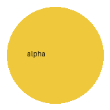

# 图片

预期：本地图片在正文内预览（最多 96 列 × 18 行）；点击图片展开对应 Markdown 源码；失败的图片显示错误但不影响编辑；网络图片默认显示“未加载”，在设置中允许本篇网络图片后才发出请求；设置中的「重新加载图片」可重试。

## 本地格式

## 尺寸

## 路径写法

![引用式图片][横图]

[横图]: assets/landscape.png

## 一段里多张图

文字  中间  结尾。

## 失败情况

上一张没有替代文字。

## 网络图片（默认不请求）

## 表格与列表里的图片

| 名称 | 预览 |
| --- | --- |
| 图标 |  |

- 列表里的图片：

  

> 引用里的图片：
>
> 

## 图片后紧跟正文

紧跟在图片下一行的文字，检查图片占位行之后的光标移动和滚动。
